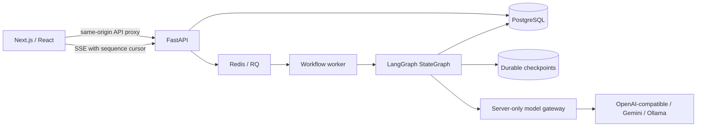
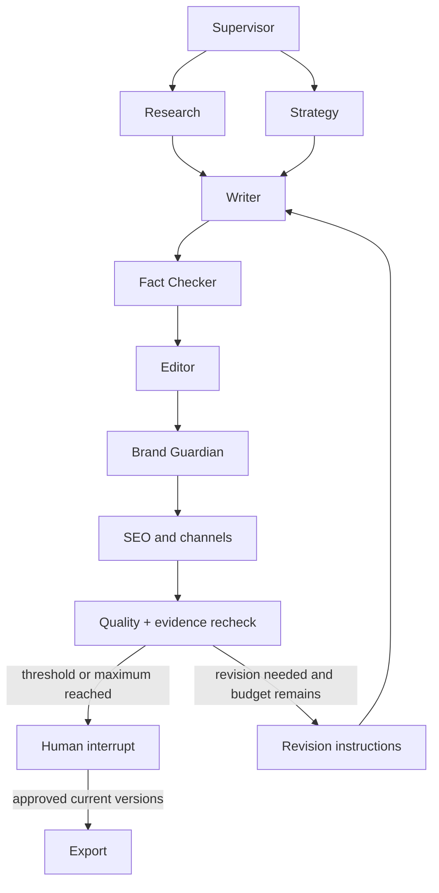

# Architecture

## System boundaries

The frontend uses App Router, TypeScript, Tailwind, shadcn-style Radix primitives, Motion, XYFlow, Recharts, TanStack Query, Zustand, and Tiptap. TanStack Query owns server data. Zustand stores only the selected run and sidebar preference. Persisted events invalidate the relevant query; browser timers never synthesize agent completion.

The backend uses FastAPI, Pydantic, SQLAlchemy, Alembic, LangGraph, and an RQ worker. Compose runs PostgreSQL and Redis. Local development substitutes SQLite and a bounded thread pool without changing the graph or API.

## Workflow

Each agent has a dedicated instruction in `backend/app/prompts.py`, a validated shared input envelope, and role-specific output validation. The state contains the run ID, brief, revision count, result map, and routing flag. Parallel branches merge results with a deterministic dictionary reducer. They write to different result keys.

The graph uses persistent checkpointers, conditional edges, a maximum of two automatic revision rounds, a recursion limit, three user-initiated failure retries, and at most five human revision cycles. Failed stages resume from the last durable graph checkpoint. Human approval resumes `interrupt()` with a validated server decision. Model text cannot approve, publish, execute shell commands, or change settings.

## Persistence

Normalized SQLAlchemy tables cover users, workspaces, sessions, projects, requests, runs, events, executions, sources, passages, artifacts, versions, claims, evidence links, quality evaluations, reviews, comments, publishing jobs, and usage records. Every workspace belongs to one account in this version; shared-workspace membership and enterprise roles are not implemented.

Artifacts retain immutable versions. Claims point to a particular version and character span. Evidence links point to persisted passages, which point to source documents with content hashes. Execution IDs connect generated artifacts and evaluated claims to responsible agents. Reviews pin the exact approved version IDs. Calendar entries pin the approved artifact version.

## Events and reconnection

An atomic database update allocates a monotonically increasing sequence within each run. Every SSE message contains an event ID, run ID, agent where relevant, event type, timestamp, sequence, and safe payload. `Last-Event-ID` or `after` selects replay after a cursor. Heartbeats keep streams alive. The browser rebuilds from the server snapshot after event notifications.

SSE responses use `Content-Encoding: identity` and `Cache-Control: no-cache, no-transform`; frontend compression is disabled to prevent streaming buffers. Deploying proxies must also disable buffering for `/api/workflows/*/events`.

## Provider gateway

The gateway adapts OpenAI chat-completions JSON, Gemini generateContent JSON, and Ollama chat JSON. It enforces timeouts and at most three transport attempts. HTTP 429 and transient 5xx responses use bounded backoff. Schema failures produce sanitized stage errors. Reported tokens are stored; absent metrics stay unavailable. Cost is estimated only when explicit server pricing is configured. No chain-of-thought is requested, exposed, or stored.

## Operational boundaries

Local startup marks abandoned runs interrupted. RQ failure callbacks mark timed-out worker jobs recoverable. A workflow must be resumed by its owner; this avoids silently repeating paid calls. Checkpoint execution can be at-least-once around a process crash between a side effect and checkpoint persistence; prior versions remain auditable. Database backups must include the application and checkpoint tables. No claim of exactly-once provider billing is made.
