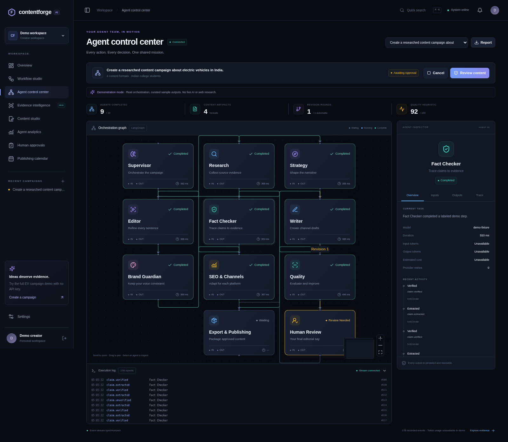
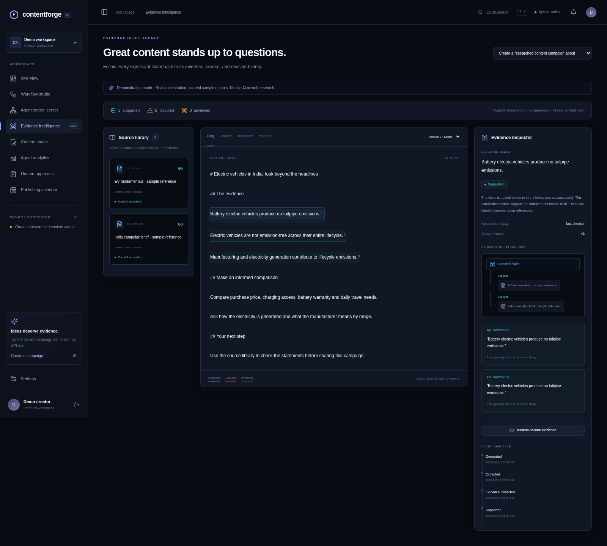

# ContentForge AI

**From an idea to verified content. Powered by collaborating AI agents.**

A multi-agent content workspace built with Next.js, FastAPI, and LangGraph. Follow ten specialized agents in a live control center, inspect claims against stored source passages, revise versioned drafts, and approve a multi-format campaign before export.

> “Supported” means a claim has linked textual evidence. It is not an independent guarantee of factual truth. The no-key demo uses clearly labeled sample references and curated outputs.

## Start in three commands

Requires Docker Engine and Docker Compose v2.

```bash
python3 scripts/configure.py
docker compose up --build -d
docker compose ps
```

Open port **3000** in your local browser. Choose **Explore the live demo** for the complete electric-vehicle campaign, or create an account for a persistent personal workspace. The generator creates a private, ignored `.env` with a random local database password; existing files are preserved.

## Develop without Docker

Requires Python 3.12+, `uv` 0.12.23, and Node.js 22 or newer.

```bash
./scripts/install.sh
./scripts/dev.sh
```

This starts the frontend on port 3000 and backend on port 8000, using SQLite and a local thread pool. Data and LangGraph checkpoints live in `backend/.data/`. Processes must restart after an environment snapshot is restored. PostgreSQL and Redis are used in Docker Compose.

## What is included

- **Agent Control Center:** interactive XYFlow graph, actual backend events, stage inputs/outputs, decision summaries, usage metrics, retry and cancellation controls, persistent event sequence replay.
- **Evidence Intelligence Studio:** source library, highlighted claims, supporting and contradictory passages, many-to-many claim/source links, human evidence assessment, and immutable version history.
- **Ten specialist roles:** supervisor, research, strategy, writer, fact checker, editor, brand guardian, SEO, quality, and export. Research and strategy run in parallel. Quality feedback is bounded. Export is gated by a durable human-approval interrupt.
- **Content Studio:** blog, LinkedIn, Instagram, and YouTube drafts; text editing, comparisons, anchored comments, revision requests, and Markdown/JSON exports. ZIP packages bundle approved documents, linked evidence, approval records, and file checksums.
- Dashboard, analytics, editorial calendar, brand preferences, dark/light/system themes, command palette, responsive navigation, authentication, and workspace ownership checks.
- Live API connection status, outage recovery, and campaign selection scoped to the signed-in workspace.
- **Campaign library:** title search, status filters, newest/oldest ordering, and server-side pagination across your campaign history. Filters stay in the page URL for reloads and browser navigation.
- **Duplicate campaigns:** review and edit a saved brief, audience, formats, source selection, and quality settings before launching a separate campaign with fresh drafts and approval.
- PostgreSQL/SQLite persistence, Alembic migrations, Redis/RQ worker, local fallback queue, Docker configuration, tests, and CI.

## Find a campaign

Open **Overview → Campaign library**. Enter part of a campaign title and press **Search**, then choose a status or creation order. **Active** includes queued and running workflows; **Needs attention** includes failed and interrupted workflows. Use **Previous** and **Next** to browse older results, and click a campaign to open its control center. **Clear filters** restores the full list.

The library refreshes every 15 seconds while visible and also has a manual refresh button. Searches and totals are scoped to your signed-in workspace. Saved page URLs retain filters; opening a URL in another account searches that account's own campaigns.

## Reuse a campaign

1. Open a campaign from **Overview → Campaign library**.
2. In its control center, click **Duplicate campaign**.
3. Review the copied brief, audience, tone, brand voice, formats, sources, execution mode, and advanced settings.
4. Click **Launch agent team** to create a new campaign.

Opening the duplicate form does not start agents. Live campaigns reuse selected source material; demo campaigns create fresh sample references. Drafts, comments, revision feedback, approvals, and schedules stay with the original campaign. If its model provider is unavailable, choose a configured execution mode before launching. The original campaign stays unchanged.

## Move an editorial reminder

Open **Publishing calendar**, find the draft in **Upcoming drafts**, and click **Reschedule**. Choose a future date and time, then click **Save new time**. The calendar moves to the selected date, and the reminder keeps the same approved content version. **Discard changes** leaves the saved reminder unchanged.

Times use your browser’s timezone. If another tab changed the reminder, close the editor and reopen it to use the latest time. Cancelled reminders cannot be rescheduled. Reminders do not publish content to external platforms.

## Download a calendar reminder

In **Publishing calendar → Upcoming drafts**, click **Download .ics** on a reminder. Import the downloaded file using your calendar app’s import command. It contains the saved reminder time, title, and approved version reference. UTC timestamps let calendar apps display the event in their own timezone; demo content is explicitly labeled.

Calendar downloads are snapshots, not subscriptions or invitations. After moving or cancelling a reminder, update or remove an earlier imported event manually; importing a newer file may create a duplicate depending on the calendar app. Downloads contain reminder metadata, not the full content draft, and do not publish content.

## Connect live models

For local development, copy `backend/.env.example` to `backend/.env`. For Compose, edit the root `.env`. Set the provider variables on the server, then restart the API and worker:

| Provider | Required configuration |
| --- | --- |
| OpenAI-compatible | `OPENAI_API_KEY`, optional `OPENAI_BASE_URL`, `OPENAI_MODEL` |
| Google Gemini | `GEMINI_API_KEY`, optional `GEMINI_MODEL` |
| Ollama | Running Ollama server, installed model, `OLLAMA_BASE_URL`, `OLLAMA_MODEL` |

Keys are never returned to the frontend. Availability badges indicate configuration presence; a live workflow establishes actual connectivity. Live-provider calls may incur charges. Demo mode needs no provider.

Live research reads user-provided text/PDFs and securely retrieved, allowlisted URLs. It does **not** perform autonomous web search. Configure trusted source hosts with `SOURCE_HOSTS`. The URL retriever pins public DNS addresses and validates TLS and redirects.

## Verification

```bash
./scripts/test.sh
# With both development servers running:
cd frontend
npx playwright install chromium
npm run test:e2e
```

See [TESTING.md](TESTING.md) for exact coverage and recorded outcomes. See [DEMO.md](DEMO.md) for the presentation walkthrough.

## Documentation





- [Architecture and data flow](ARCHITECTURE.md)
- [Agent contracts and development instructions](AGENTS.md)
- [Evidence semantics and traceability](TRACEABILITY.md)
- [Downloadable campaign packages](EXPORTS.md)
- [Deployment and operations](DEPLOYMENT.md)
- [Tests and validation](TESTING.md)
- [College demonstration](DEMO.md)
- [Viva preparation](VIVA_GUIDE.md)

## Practical limits

This is a working production-oriented reference project, not a claim of audited production readiness. Claim extraction and the quality rubric are deliberately transparent heuristics. Live generation must be reviewed. Export and editorial scheduling work; external social publishing is not connected. Rich-text editing controls save plain text, so formatting marks are not retained. The built-in guest demo is intended for local presentations; disable it for public deployments. See deployment notes for scaling, recovery, and security boundaries.
